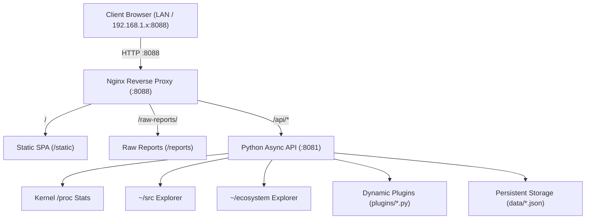

# Architecture & Technical Design

## System Overview

`local-intranet-portal` operates as a dual-process intranet gateway and developer dashboard designed for local networks.

## Component Boundaries

1. **Edge Router (Nginx 1.31):**
   - Dual-stack socket binding on `0.0.0.0:8088` and `[::]:8088`.
   - Compresses text, json, and javascript assets using gzip.
   - Serves static dashboard files directly and terminates static asset requests.
   - Auto-indexes `/raw-reports/` directly from the `reports/` volume.

2. **API Substrate (Python 3 Server):**
   - Pure standard library HTTP server running on `127.0.0.1:8081`.
   - Interrogates Linux `/proc/meminfo`, `/proc/uptime`, and load averages without polling external daemons.
   - Enforces strict path traversal boundaries (`resolve().relative_to(target_root)`) for source navigation.

3. **Pluggable Architecture:**
   - Any Python script dropped into `plugins/` that exports `handle_request(method, query, body)` automatically mounts at `/api/plugins/<stem>`.
   - Enables plugging in auxiliary frameworks, test runners, or scraping agents underneath the existing gateway.
